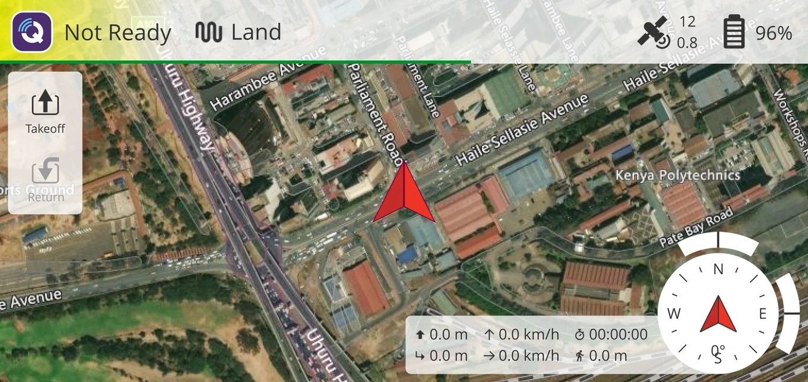
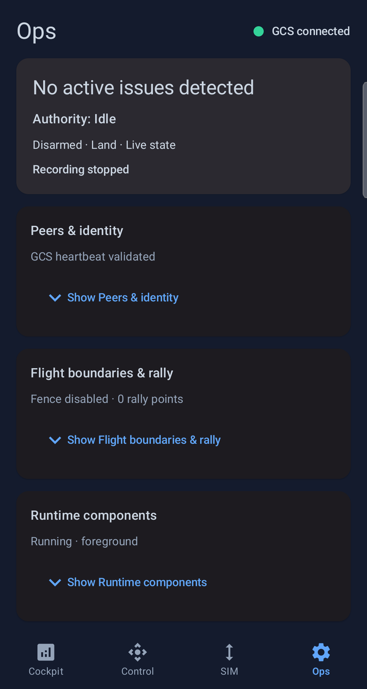
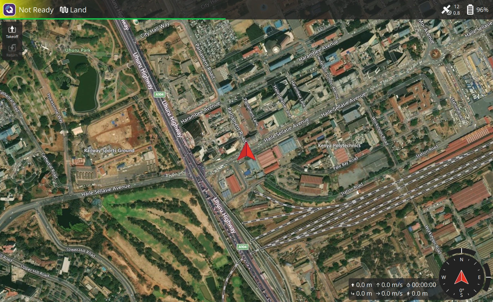
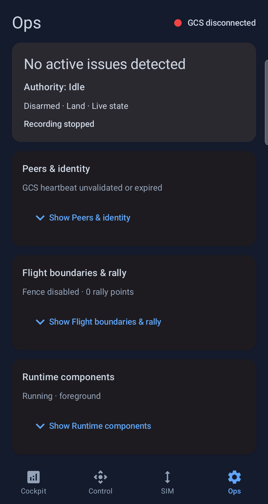
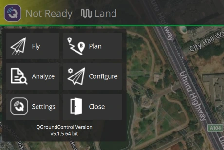

# Connect QGroundControl

Connect QGroundControl (QGC) to the simulated vehicle in MAVLab v1.6.1. You can use QGC for live MAVLink telemetry and supported mission and flight commands. MAVLab continues to run the simulation on Android. These steps were checked with QGC v5.1.5 on Android and Linux.

Install [MAVLab](../setup_guide.md) and get the Android or desktop build from [QGroundControl's download guide](https://docs.qgroundcontrol.com/Stable_V5.1/en/qgc-user-guide/getting_started/download_and_install.html).

Keep the simulated vehicle **disarmed** while checking the connection. Use one MAVLab instance and one QGC instance on the test network, away from any real aircraft using MAVLink.

## Same Android device

MAVLab v1.6.1 installs on Android 8.0 or later. QGC 5.1 for Android requires Android 9 or later. On an Android 8 phone running MAVLab, use the [desktop connection](#desktop-over-wi-fi) for QGC 5.1. See [QGC's Android requirements](https://docs.qgroundcontrol.com/Stable_V5.1/en/qgc-user-guide/getting_started/download_and_install.html#android).

1. Open MAVLab and check that **Cockpit** shows **READY · DISARMED**.
2. Use the Android app switcher to open QGC within one minute. Split-screen is optional.
3. In QGC, tap the purple **Q** at the upper left, then choose **Fly**. Wait for the simulated vehicle to appear and check that QGC shows GPS and battery values.
4. Switch back to MAVLab and tap **Ops**. Look for **GCS connected** and **GCS heartbeat validated** under **Peers & identity**. The indicator needs about three seconds of continuous validated QGC heartbeats to turn green.

MAVLab sends same-device telemetry to `127.0.0.1:14550`. Phone sensor input suspends when MAVLab goes to the background. A validated GCS link, armed flight, or active mission can retain the runtime. If it remains idle and disconnected after the handoff window, open MAVLab again before retrying.

## Desktop over Wi-Fi

1. Connect the Android phone and the desktop to the same trusted Wi-Fi network or the same hotspot. Choose a network that allows devices to talk to each other.
2. Open QGC on the desktop and leave UDP auto-connect enabled. Open MAVLab on Android and keep it visible while checking the link.
3. In QGC, open **Q → Fly** and check that the simulated vehicle appears with telemetry. Then open **Ops** on the phone and check **GCS connected**.

MAVLab broadcasts to QGC on UDP port `14550`. The normal inbound port for commands to MAVLab is UDP `14551`. MAVLab uses vehicle system ID `1` and component ID `1` by default. QGC normally uses ground station system ID `255`.

## Verify the link before uploading

A valid peer heartbeat turns the MAVLab indicator green. Check QGC for GPS, battery, and flight mode to confirm it is receiving the simulated vehicle's data. The screenshots show a connected vehicle disarmed in **Land** mode after touchdown, so QGC displays **Not Ready** for flight.

To start a mission, follow [Mission operation](mission.md) and check **Ops → Mission upload** for the transfer result. Confirm **AUTO** and mission progress after starting the mission.

When finished, land and disarm in MAVLab if needed, then disconnect or close QGC. Check **GCS disconnected** in Ops after about 15 seconds without a heartbeat.

## Troubleshoot discovery

Open the purple **Q** menu and select **Settings → Comm Links** to check UDP auto-connect or configure a manual UDP link.

| What you see | What to check |
| --- | --- |
| QGC shows no vehicle on the same phone | Reopen MAVLab and switch to QGC within one minute. Verify **UDP** auto-connect in QGC settings. |
| Desktop QGC shows no vehicle | Check that both devices use the same network. Guest Wi-Fi often isolates clients. Allow inbound UDP `14550` through the desktop firewall. |
| UDP auto-connect is off | Enable **UDP** in **Comm Links**. If you need a manual UDP link instead, use **Add New Link**, choose **UDP**, and set its local listening port to `14550`. Configure one listener on that port. |
| QGC sees the vehicle but MAVLab stays disconnected | Allow time for the continuous heartbeat check. Verify that QGC sends a heartbeat and that the system IDs differ. Reconnect if you changed QGC settings. |
| Upload fails after the connection works | Keep the simulated vehicle disarmed and inspect **Ops → Mission upload** for the rejected item, missing sequence, or timeout. |

See [First-run troubleshooting](../known_first_run_issues.md), the [MAVLink contract](../internals/mavlink-contract.md), and [QGC Comm Links](https://docs.qgroundcontrol.com/Stable_V5.1/en/qgc-user-guide/settings_view/comm_links.html) for link details.
