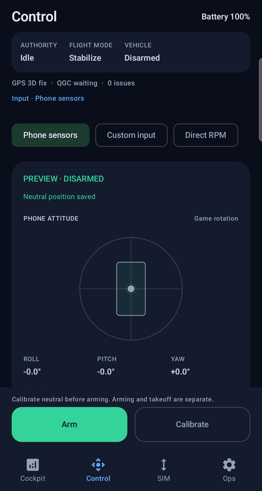
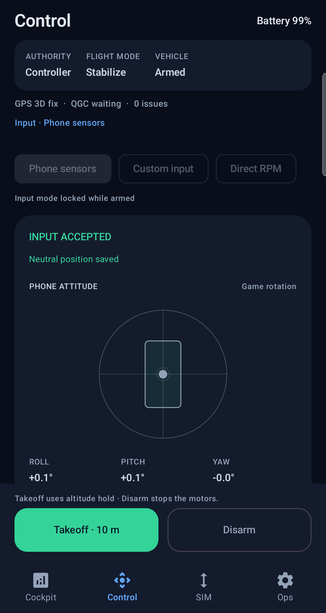
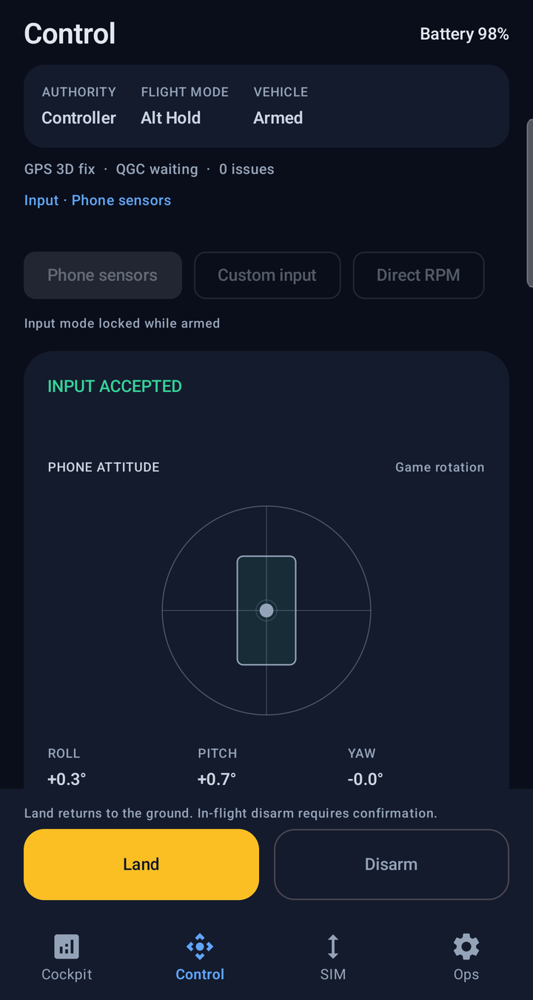
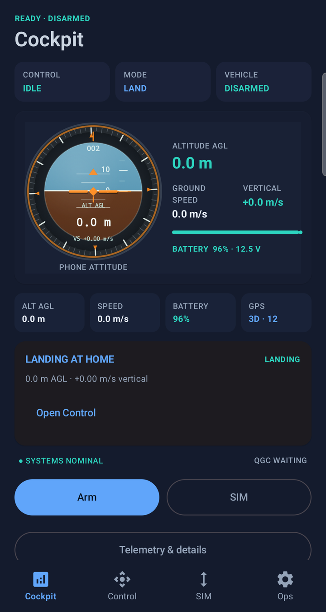

# First flight on Android

Run a local simulated flight with MAVLab v1.6.1. After [installing the APK](../setup_guide.md), you can complete this flight offline using the phone alone.

## 1. Open Cockpit

Complete or skip [onboarding](onboarding.md). **Start flying** opens **Cockpit**. Check that it shows **READY · DISARMED** and **ALT AGL** (altitude above ground level) is at 0 m.

## 2. Set up phone steering

1. Tap **Control** in the bottom bar and select **Phone sensors** if a different input mode is selected.
2. Hold the phone comfortably and still in the position you want to use as level. Tap **Calibrate** in the grounded action dock or under **Calibration & control setup**. Wait for the confirmation that neutral was saved.
3. To change the default 10 m takeoff, open **Calibration & control setup** and find **Takeoff height · metres above ground**. Choose 5, 10, or 20 m before arming.

The ground preview shows the calibrated phone attitude. If phone sensors are unavailable, select **Custom input** while disarmed and use the on-screen controls. See the [Control reference](controller.md) for the input modes.

## 3. Arm, take off, and inspect the flight

1. Tap **Arm** in Control. Check that the vehicle is armed and still on the ground.
2. Tap **Takeoff · 10 m**, or the height you selected. MAVLab uses altitude hold for the climb while accepting phone attitude input. Gently tilt the phone to steer, or keep it near neutral to observe the climb.
3. Open **Cockpit** to check the rising altitude and then **SIM** to see the same simulated vehicle. Tap the bottom tabs or follow the [navigation guide](navigation-and-display.md). Keep MAVLab visible when steering with the phone.

## 4. Land and disarm

Open **Control** and tap **Land** while airborne. Wait for touchdown and check that **ALT AGL** has returned to ground level in **Cockpit**. Landing can disarm the simulated vehicle on touchdown. If it still shows **ARMED** on the ground, return to **Control** and tap **Disarm**. Confirm **DISARMED** in **Cockpit**. Use **Land** for normal flight completion because disarming in flight immediately cuts simulated motor thrust.

For a flight you want to review later, tap **Begin recording** in **Ops → Recordings & review** before arming. Use **Stop and save** after landing. Recording is opt-in and managed separately from flight actions. See [Ops](ops.md) for review and export.

For a ground station connection, continue to [Connect QGroundControl](connect-qgroundcontrol.md).
