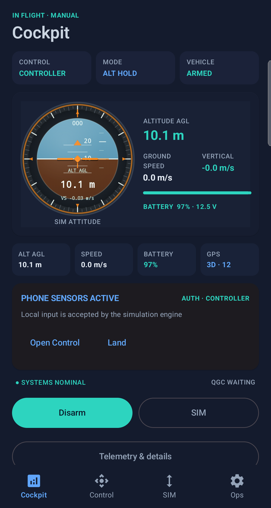
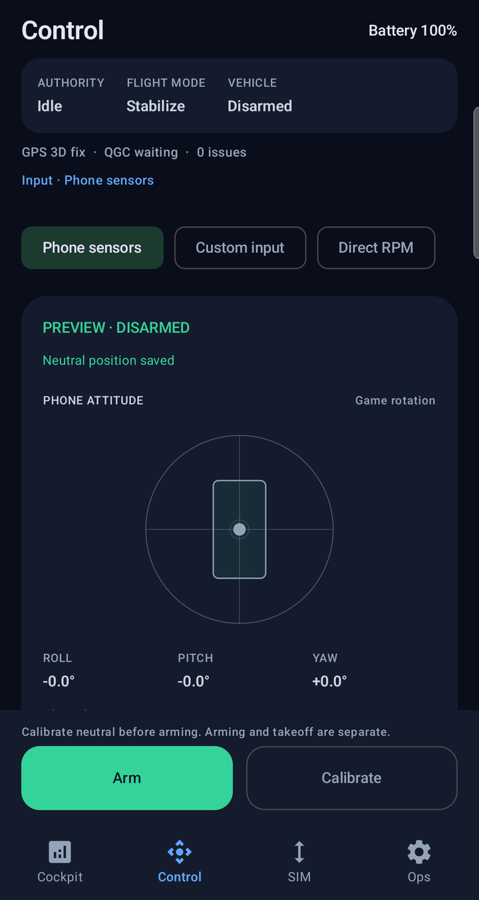
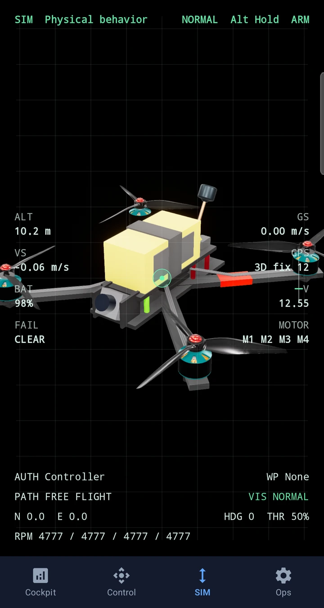
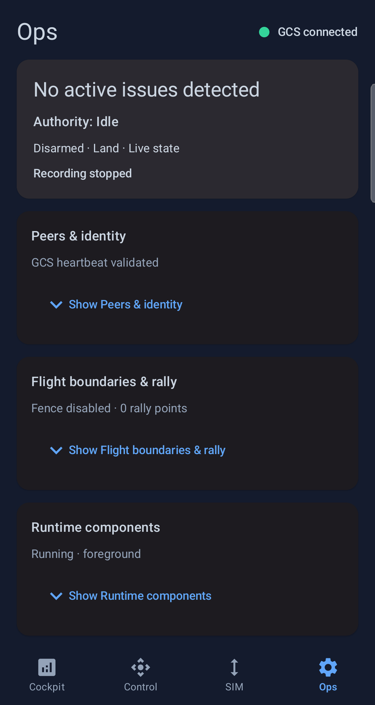

# Navigate MAVLab

Use the bottom bar to move between **Cockpit**, **Control**, **SIM**, and **Ops** in MAVLab v1.6.1. Each screen shows or controls the same simulated vehicle. The four destinations remain visible in full-screen mode.

## Cockpit

Check who has control, the flight mode, and whether the vehicle is armed in the row at the top. The instruments show attitude, altitude above ground, speed, battery, and GPS. Open **Telemetry & details** for more readings or use **Open Control** to get to local flight actions. See the [Cockpit reference](cockpit.md).

## Control

Select an input mode while disarmed. With **Phone sensors**, calibrate neutral and check the attitude preview. The flight-action dock at the bottom changes with the vehicle state. Find mission actions here when a received plan is available. See the [Control reference](controller.md) or follow [First flight on Android](first-flight.md).

## SIM

Check the 3D view and its flight-state readouts while the simulation is running. Drag in the 3D view to orbit and pinch to zoom. When a mission is loaded, tap **View received route** for the plan and the flown trail. See the [SIM reference](sim.md).

## Ops

Check the QGC connection at the top, review runtime and peer status, and scroll to find **Recordings & review**, **Display**, and **Advanced configuration**. After sending a plan from QGC, check **Mission upload** for the outcome. See the [Ops reference](ops.md).

## Tap or swipe

Swipe left or right across passive content to move one screen at a time. In **Cockpit** and **Ops**, swipe over informational cards or the space around them. In **Control**, use the status header or phone-tilt preview. In **SIM**, use the top status strip or **Received route** title. **Cockpit** and **Ops** are the ends of the sequence.

Sliders, switches, fields, mission actions, route gestures, and the 3D camera keep their own input. Use the bottom tabs when a screen is mostly interactive. Screen-swiping is disabled during text entry and TalkBack touch exploration. Android system gestures remain available at the edges.

A short horizontal swipe or quick flick is enough. Drag back to the starting point to cancel the swipe. Partially visible screens during the transition are previews. On **Cockpit** and **Ops**, a horizontal drag over a button cancels its tap. Release and tap normally to activate it.

## Full screen

In **Ops → Display**, enable **Full screen** to hide Android's status and navigation bars. Reveal them temporarily using Android's system-edge gesture. MAVLab's four navigation buttons remain visible. Turn the setting off to return to standard display. The preference is saved across launches and applies to all four screens.

Standard display is the initial default. The app uses the screen edges for its background while keeping text and controls clear of camera cutouts and system-navigation areas. The bar expands when larger text needs more space. Keyboard and multi-window interaction can show Android bars even when Full screen is selected.

The Android launch window and splash background match MAVLab's dark display, avoiding a white flash before the app draws.

## Flight continuity

Changing screens or display mode does not arm, disarm, land, change control authority, or stop recording. Armed Phone Sensors input continues through the simulation engine while MAVLab is visible, including in Cockpit, Control, and SIM. GCS Mission authority and explicit recovery modes retain their control rules. Backgrounding MAVLab still suspends phone-sensor input.

Useful screen view state, including scroll positions and expanded detail, survives screen switching. Android Back closes the received-route view or expanded mission detail before following the existing exit behavior. Vehicle state remains owned by the runtime; restoring a screen does not create a new flight.
